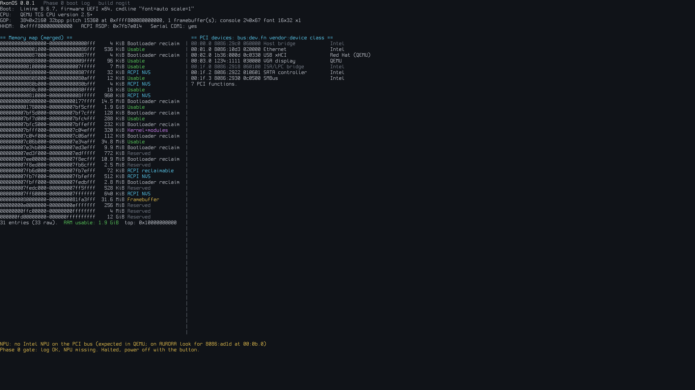

# AxonOS

Своя ОС с нуля для x86_64 UEFI, где CPU управляет, а тяжёлую работу с пикселями и данными делает NPU.
Первое железо: AURORA (Intel Core Ultra 9 285HX, Arrow Lake, NPU 3-го поколения).

Сейчас: **Фаза 0**. Ядро грузится через Limine, выводит лог на экран (GOP framebuffer, читаемо в 4K)
и в серийный порт: карту памяти, список PCI-устройств и найденный NPU (vendor 8086).



## Быстрый старт

Готовый образ без сборки: вкладка **Actions** → последний зелёный запуск `build` → артефакт `boot-image`
(внутри `axonos.img`, `axonos-esp.zip`, скриншот из QEMU).

Запуск на AURORA: **[docs/aurora-boot.md](docs/aurora-boot.md)** (BitLocker, Secure Boot, запись на USB-SSD, что должно быть на экране).

## Сборка (Ubuntu 24.04 или WSL2)

```sh
sudo apt install clang lld make git gdisk mtools zip qemu-system-x86 ovmf
make img        # build/axonos.img: GPT + FAT32 ESP, для dd / Rufus
make esp        # build/esp/ и build/axonos-esp.zip: те же файлы для копирования на FAT32-раздел
make run        # QEMU + OVMF в окне, серийный лог в терминале
RES=3840x2160 make run
make smoke      # загрузка без окна, проверка лога, скриншот build/screen.ppm
```

Limine (готовые бинарники, ветка `v9.x-binary`, зафиксированный коммит) скачивается при первой сборке
в `third_party/limine` скриптом `scripts/fetch-limine.sh`.

## Параметры ядра

Строка `cmdline:` в `boot/limine.conf` (на флешке: `\boot\limine\limine.conf`, правится из Windows):

| Параметр | Значения | Что делает |
| --- | --- | --- |
| `font` | `auto`, `8x16`, `16x32` | `auto`: 16x32 на экранах от 1440 строк (4K), иначе 8x16 |
| `scale` | `1`, `2`, ... | целое увеличение шрифта; само уменьшается, если не влезает 80x25 |
| `test` | `panic` | намеренно вызывает page fault, чтобы проверить экран паники |

## Устройство

```
kernel/
  linker.ld                 ядро в верхних 2 ГиБ (0xffffffff80000000)
  include/limine.h          протокол Limine (0BSD)
  src/main.cpp              точка входа kmain, запросы Limine, лог Фазы 0
  src/arch/x86_64/          cpu.h (port I/O, cpuid), idt + isr.S (исключения -> экран паники)
  src/drivers/serial.cpp    COM1 115200 8N1 (на ноутбуке без UART просто молчит)
  src/gfx/console.cpp       текстовая консоль на GOP: сетка символов в RAM, панели, перерисовка грязных строк
  src/gfx/fonts/            шрифт Spleen 8x16 и 16x32 (BSD-2), сгенерирован tools/bdf2c.py
  src/pci/pci.cpp           перебор PCI через 0xCF8/0xCFC, классы, ID NPU Intel (как в Linux ivpu)
boot/limine.conf
scripts/                    fetch-limine.sh, make-image.sh, run-qemu.sh, qemu-smoke.sh
userspace/                  (с Фазы 1) сервисы user space, лицензия MIT
```

Тулчейн: clang/lld, `--target=x86_64-unknown-none-elf`, C++20 freestanding без исключений и RTTI,
без SSE в ядре, `-mcmodel=kernel`, `-mno-red-zone`.

## Лицензии

- Ядро и всё вне `userspace/`: **GPL-2.0-only** (`LICENSE`). Это позволяет портировать код Linux `ivpu` в Фазе 3.
- `userspace/`: **MIT** (`userspace/LICENSE`).
- Сторонние: Limine (BSD-2, `LICENSES/Limine-BSD-2-Clause.txt`, `limine.h` под 0BSD), шрифт Spleen (BSD-2, `LICENSES/Spleen-BSD-2-Clause.txt`).
